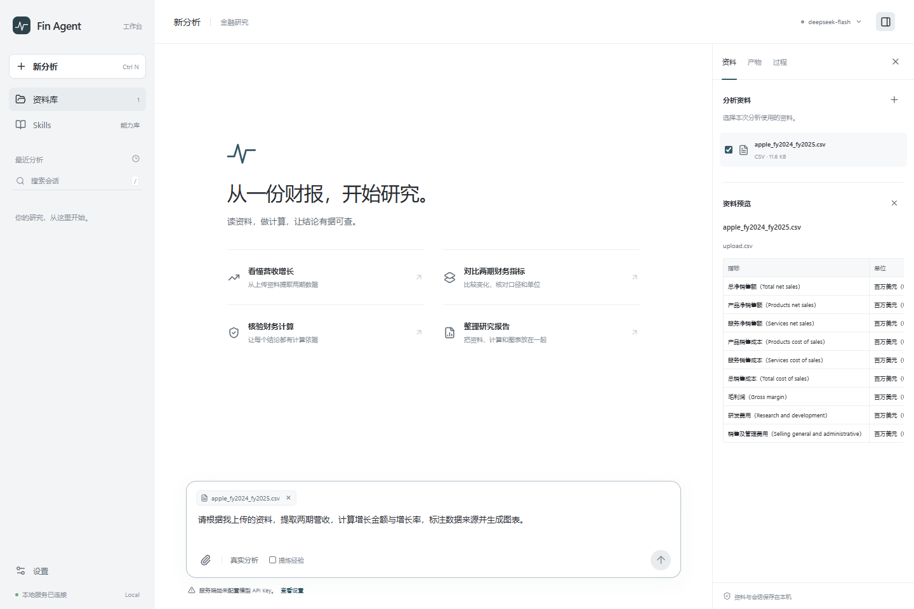

# fin_agent

一个以来源证据为基础的金融研究 Agent：读财报、执行计算与 Python/Shell、生成报告和图表、持续保存会话，并把开发失败提炼成经过验证才能启用的技能。

项目只保留一条 Agent 运行循环。金融方法、Docker 终端、记忆、技能和评估各自有明确模块；不依赖 LangGraph。设计参考 Dexter 的按需技能、FinRobot 的金融方法分层和 RD-Agent 的实验反馈。来源说明见 [NOTICE.md](NOTICE.md)。

仓库由原 `my_agent` 迁移为 `fin_agent`，主分支使用第二版金融实现；原型保留在 [归档分支](https://github.com/William-Li123/fin_agent/tree/archive/my-agent-before-fin-agent-20261010)。Python 发行包名仍为 `finance-research-agent`，导入包和命令仍为 `finagent`。

## 能做什么

| 能力 | 实现 |
| --- | --- |
| 文档研究 | JSON、CSV、TXT/Markdown、PDF 文本、XLSX 缓存值导入；多文档作用域、正文/表格检索、位置与 SHA256 引用 |
| 财务计算 | Decimal 算术、金额规模/百分比/基点转换、同比比较、来源绑定的计算回执 |
| 真实终端 | 默认 Docker 的 Python/Shell、批量 SDK 调用、文件持久化、后台作业、超时和清理 |
| 输出 | 结构化答案、Markdown 报告、SVG 图表、逐步轨迹与完整工具日志 |
| 上下文与记忆 | 有界上下文、归档回读、SQLite 会话、文档哈希隔离、历史检索和用户偏好 |
| Skills | 六个预置方法；元数据发现、按需正文、版本、禁用、启用、回滚 |
| 失败学习 | 开发失败→模型提炼候选→隔离→独立双臂验证→晋升/拒绝；测试标签不回流 |
| 外部能力 | 可选 stdio MCP 白名单适配器；可以从终端批量调用 |
| 工程验证 | 持久化费用上限、用量审计、真实 API 验收、按题顺序执行的 FinQA 评估 |

这里的完整性指**文档金融研究闭环**。不包含实盘交易、已接入的商业行情服务、PDF OCR 或 Excel 公式重算。引用有效、算术执行正确，也不能保证会计口径和判断永远正确。

**目前模型质量验证主要基于 FinQA 财报片段。** Docker 报告、图表和记忆追问已真实跑通，但使用的仍是单页片段；多文档、完整年报和完整估值任务尚无真实 API 质量验收。能力实现与验证范围见 [实际验收](docs/validation.md)。

## 安装与开始

需要 Python 3.11+。Docker 是执行代码时的默认后端。

```shell
git clone https://github.com/William-Li123/fin_agent.git
cd fin_agent
```

```powershell
python -m pip install -e ".[documents,dev]"
docker build -t finance-agent-terminal:local -f docker/Dockerfile .
finagent doctor
```

## Web 界面

本地研究界面参考 Codex 的会话与工作区布局：左侧管理研究会话，中间提问和查看答案，侧面查看资料、执行过程和报告。支持上传文档、切换会话、追问、停止后续执行，以及查看 Skills 与学习候选。

```powershell
python -m pip install -e ".[web,documents]"
cd frontend
npm ci
npm run build
cd ..
finagent --state .finagent web --port 8000
```

打开 **http://127.0.0.1:8000**。新分析从空资料开始，上传并选择自己的文档后提问。分析使用服务端的 `DEEPSEEK_API_KEY` 与已有预算账本；上传和预览不会调用模型。页面不接收或保存密钥，也不会初始化、重置或提高预算。

Windows 已配置用户本地 DPAPI 加密凭据缓存时，可重复执行 `./scripts/start-local-web.ps1` 启动；脚本优先复用已有环境变量，否则解密 `%LOCALAPPDATA%/FinAgent/deepseek-key.dpapi` 到当前进程，关闭后恢复环境，不打印密钥或修改预算。可用 `-PythonExe`、`-State` 和 `-Frontend` 指定本地路径。

开发时先启动上述 Python 服务，在另一个终端执行 `cd frontend; npm run dev`，访问 Vite 提供的本地地址。完整运行方法、接口和验证范围见 [前端与 Web 服务](docs/web-interface.md)。

仓库提供一份从 Apple 官方财报整理的 [2024–2025 财年真实 CSV](examples/real-data/apple_fy2024_fy2025.csv)，以及 [配套问题](examples/real-data/Apple财务分析问题.txt)。可直接上传开展营收、利润率、产品与地域贡献分析。数据来源和口径随文件提供。



模型默认是 `deepseek-flash`，API 根地址为 `https://api.deepseek.com`。`platform.deepseek.com/api_keys` 是账户管理网页，不能作为模型接口。

凭据仅从 `DEEPSEEK_API_KEY` 进程环境变量读取，不需要写入仓库。PowerShell 7 可用交互输入设置当前窗口的变量：

```powershell
$env:DEEPSEEK_API_KEY = Read-Host "DeepSeek API key" -MaskInput
```

Bash 可使用：

```bash
read -rsp "DeepSeek API key: " DEEPSEEK_API_KEY
export DEEPSEEK_API_KEY
```

首次使用一个**全新**状态目录时，初始化自己授权的预算，再运行：

```powershell
finagent --state .finagent budget init --ceiling 50 --carried 0
finagent ask "比较这家公司两年的营收，计算增长率并说明来源" --input examples/company.json --session demo
finagent ask "解释上一轮计算所用的分母" --input examples/company.json --session demo
finagent budget status
```

`examples/company.json` 是明确标注的合成演示数据。真实 API 验收使用公开 FinQA 年报资料，见 [验收记录](docs/validation.md)。

后续对旧版原 50 题进行固定条件回归：答案正确率 **35/50→42/50（70%→84%）**，工程失败 **2→0**，本轮估算费用 **¥1.63**。详细配对、token、费用和得分局限见 [50 题对照报告](docs/same50-comparison.md)。

从单次模型基线、原始 `my_agent` 到两代金融 Agent 的代码与结果演进，见 [进步原因分析](docs/agent-progression-analysis.md)。报告逐题解释增分与退步，区分实际使用的能力、机制推断和仍需消融的贡献。

已有 `.finagent` 账本应继续使用，不能通过新建或清零状态目录绕过累计上限；外部已发生费用应在首次初始化时通过 `--carried` 纳入。`budget status` 只读，不产生模型费用。所有生成、提案修复和技能验证共用此账本，按配置费率保守计价，并非供应商实扣账单。历史实验费用见 [验收记录](docs/validation.md) 与 [50 题报告](docs/same50-comparison.md)。

## 导入自己的材料

```powershell
finagent ingest annual-report.pdf --output data/my-report
finagent ask "分析经营利润变化并生成报告" --input data/my-report/生成的文件名.json --session company-research
```

`ingest` 会返回真实输出路径。多份材料可重复传 `--input`。JSON 输入必须只有 `id / question / pre_text / post_text / table` 五个字段；原始 FinQA 资料需走评估准备器，以隔离标签。

## 目录

```text
src/finagent/
  cli.py             唯一命令入口
  core/              单一运行循环、上下文、最终校验
  models/            API 客户端与持久预算
  tools/             财务工具、证据、终端、SDK、MCP
  memory/            会话及来源作用域记忆
  skills/            技能目录与六个内置 SKILL.md
  learning/          失败、候选、验证、晋升
  ingestion/         本地文档导入
  evaluation/        固定数据与宿主机评分
  web/               本地 HTTP 接口、研究会话和运行任务
frontend/            React/TypeScript 研究界面
tests/               功能、边界、离线及 Docker 测试
docs/                架构、工具、技能、运行与验收说明
examples/            小型示例输入
scripts/             本次真实验收的可复现驱动
docker/              终端镜像
```

`.finagent/`、`data/`、`runs/` 均由 Git 忽略。源码中没有 API Key、历史实验输出或旧版备份。旧项目仍保留在原目录，新仓库可独立安装。

## 技能与学习

```powershell
finagent skills list
finagent skills show source-alignment
finagent ask "分析这份材料" --input examples/company.json --learn-on-failure
finagent learn list
```

`--learn-on-failure` 会为本轮工具/运行失败生成候选，不会自动把候选变成正式技能。真实业务回答是否正确，需要外部反馈或开发评估器判定；不能靠模型自我表扬算作成功。

开发评估也可自动反馈答错的题：`finagent eval run --manifest data/finqa/host/manifest.json --output runs/dev-learn --split dev --learn-on-failure`。反馈包含失败诊断和运行轨迹，不向提案模型提供标准答案；测试集禁止此开关。

之后用开发案例进行对照验证。至少三个不同来源组，排除失败题及同源材料；无退步、至少一项改善且无评估异常才允许晋升。生产命令必须明确执行 `learn promote`；验收脚本也只在验证通过时调用它。

完整命令、候选格式和回滚见 [技能与学习](docs/skills.md)。

## 测试与评估

```powershell
python -m pytest -q
$env:FINAGENT_DOCKER_TESTS = "1"
python -m pytest -q
finagent eval prepare --output data/finqa --dev-count 12 --test-count 12
finagent eval run --manifest data/finqa/host/manifest.json --output runs/my-test --split test
```

单元测试及 Docker 测试不调用模型；`eval run` 调用模型并扣费。每题完成后才开始下一题。报告使用全部冻结题目作分母，错误和未完成均计错，测试期间禁止修改实现和技能目录。

当前 FinQA 指标为 `custom_answer_accuracy`：原始 `exe_ans` 数值尺度、五位小数匹配。**不是官方 program accuracy，也不是实盘收益指标。** 小样本结果不应直接与论文或旧项目成绩比较。

更多说明：[架构](docs/architecture.md) · [工具与终端](docs/tools.md) · [技能](docs/skills.md) · [运行手册](docs/operations.md) · [实际验收](docs/validation.md)
