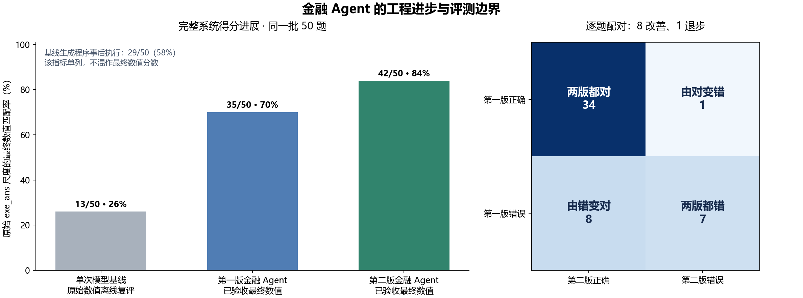
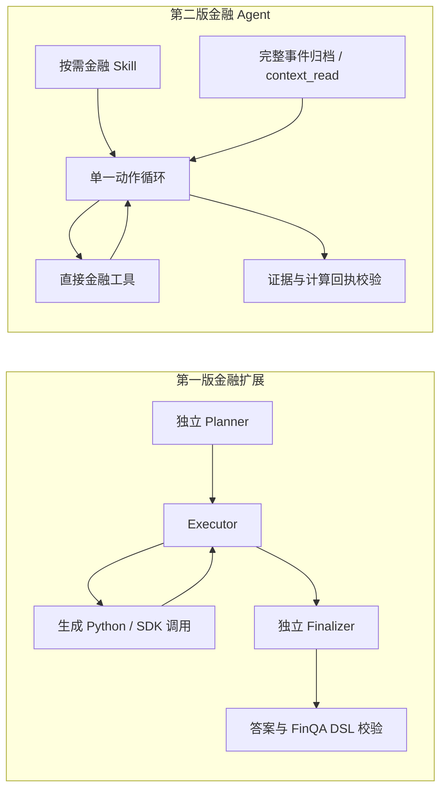

# 从单次模型基线、my_agent 原型到第二版金融 Agent：进步与原因分析

研究日期：2026-10-10。分析对象是已经保存的源码、真实 API 响应、工具轨迹、评测输入与费用账本。本次研究没有新增模型请求；主要性能与费用对比来自之前固定的同一批 50 题。

## 1. 最有证据支持的判断

第二版在这批短财报数值问题上表现更好，核心进步是**让模型承担任务理解与动作选择，让宿主工具承担计算，让明确的状态和回执承担结果交付**。与第一版相比，第二版减少了通用 Python 生成、独立规划和最终转写等环节，给简单任务提供了更直接的执行路径。

结果是第一版的 **35/50（70%）提升到第二版的 42/50（84%）**，工程失败从 2 题降至 0 题。逐题不是全部改善：8 题由错变对、1 题由对变错，净增 7 题。

证据可以分为三层：

| 层级 | 本研究能支持的结论 |
| --- | --- |
| 已直接核实 | 三组有评测的系统使用相同 50 个 ID 和顺序；35→42；旧两道工程失败恢复；调用与费用逐项可核对 |
| 有轨迹支持的机制解释 | 旧版某些题已经算对，随后被模型忽略或被 DSL 输出契约拒绝；新版具体执行路径避开了这些故障 |
| 尚需实验的归因 | 单循环、技能正文、归档回读分别贡献多少分；在等调用或等 token 预算下是否仍优于对照 |

所以可以说“第二版在这次完整系统比较中更好”，但不能说“单循环本身带来了 14 个百分点”，也不能把本次提高归功于未使用的终端、MCP、跨题记忆或自动学习技能。

## 2. 首先把四个对象与评分口径区分清楚

“基线→你的→第二版”在代码层面实际上包含四个对象：

| 阶段 | 实际对象 | 同 50 题结果 | 身份与边界 |
| --- | --- | --- | --- |
| B0：单次模型基线 | 完整净化财报片段→一次 `deepseek-flash` 请求→输出 answer/program | 原始数值答案离线复评 **13/50，26%**；严格提交验收 **9/50，18%** | 没有运行你的 Agent 图，也没有交互式工具调用 |
| P0：你的原始原型 | `William-Li123/my_agent`，提交 `77216163b3dc8c29c74d8478e537f8261b236335` | **没有发现同 50 题的可比成绩** | 通用 Agent 工程基础，原有测试是 RAG 与 Python 教程问答 |
| F1：第一版金融扩展 | 在 P0 上增加金融 Profile、财务 SDK、上下文适配、真实数据评测 | 已验收最终答案 **35/50，70%**；官方 DSL 执行 35/50，程序匹配 31/50 | 前一份截图中的 70% 指这一阶段 |
| F2：第二版金融 Agent | 独立 `finagent` 包、单动作循环、直接金融工具、技能与回执校验 | 已验收最终答案 **42/50，84%** | 没有输出可等价评分的 FinQA DSL；程序准确率缺失 |

**B0 不是未经改造的 `my_agent` 的成绩。P0 不能被填入一个推测准确率。** 第一版也不是纯粹的原型：它已经包含此前实施的金融特化。

基线还有一个重要成绩：对已经生成的程序做事后规范化并执行，忽略原始 answer 是否一致，得到 **29/50（58%）**。这是“程序表达能否得到正确数值”的诊断视角，不能和 26%、18%混写成同一个准确率。相同解码器同时要求程序与 answer 一致时，基线为 12/50（24%）。第一版未验收的最后 finalizer 原始数值离线复评为 36/50（72%），验收后为 35/50（70%）。

这组结果说明：基线的低数值得分包含输出尺度、精度和程序协议问题。它不是每一道低分题都完全不理解金融公式。例如第一道燃油题，基线解释已经写出 `(8959-8717)/8717`，但 answer 是展示百分数 `2.78`，而基准期望原始比率约 `0.02776`，程序还用了旧严格解析器不接受的嵌套写法。



图左使用共同的 `exe_ans` 数值比较尺度，但 B0 是原始输出事后复评，F1/F2 是验收后答案，输出契约和计算预算仍有差异。图中的 26%→70%→84% 是系统行为进展，不是单变量算法消融。

FinQA 的原始设计包含金融文档问题与可执行推理程序，因此答案数值、程序执行和程序等价是需要区分的评价视角。本项目的标量评分不应直接与论文中的其他模型或官方程序分数横向排名。[FinQA 原始论文](https://arxiv.org/abs/2109.00122)

## 3. 你的原型提供了哪些真正有价值的基础

原型已经实现 `planner→executor→tool/replan→finalizer` 的 LangGraph 工作流，以及 RAG、Oracle 对话/摘要/人设记忆、MCP、会话文件系统、OpenSandbox 终端。控制依靠状态路由，没有一个独立的 LLM controller 节点。原型的贡献是建立了**任务规划、行动、观察、再决策、会话状态和外部能力接入**的完整骨架。[原型工作流源码](https://github.com/William-Li123/fin_agent/blob/77216163b3dc8c29c74d8478e537f8261b236335/backend/agent/graph.py#L11)、[原型记忆源码](https://github.com/William-Li123/fin_agent/blob/77216163b3dc8c29c74d8478e537f8261b236335/backend/memory/service.py#L82)

这对复杂、跨工具、跨会话任务是合理的基础。例如检索外部资料、写入文件、执行代码，再继续用户追问，需要不同服务协作。第二版并不是首次补上这些能力，而是把其中适用于本地金融研究的部分重新组织。

原型的局限主要来自“通用接口距离金融判定还很远”。通用记忆能保存文本，却不能自动证明某笔金额的年份和单位；通用终端能运行代码，却不证明公式分母合适；MCP 能连接工具，却不证明工具观察被正确使用。将这些组件拼好，是工程可运行的起点，金融质量还需要更具体的契约和评测。

另一个区别是任务范围。原型采用 MarkItDown、Qdrant、向量检索及 Oracle 记忆；第二版当前文档检索主要是词法检索、结构化表格和 SQLite 会话。对于已经给定相关短财报片段的 FinQA，这种实现更轻，便于复现；它并不证明第二版在海量文档语义检索上优于原型。

## 4. 第一版金融特化带来了什么，付出了什么

第一版把通用骨架变成可评测的金融任务系统：输入净化为五字段资料，标准答案放在宿主侧；通过 SDK 读取表格、检索证据、计算数值；要求来源可追踪、答案与程序执行一致；加入真实 Docker、预算、逐题轨迹和固定数据集。

这一阶段的重要进步是把“模型说自己算对了”改成“公式实际执行过，输出有来源和评分记录”。程序计算与语言推理分工的思路与 Program of Thoughts 相符；外部执行能修正纯语言算术的不足，但公式与取数仍需要模型决定。论文为这种分工提供研究背景，不构成本项目得分的因果证明。[Program of Thoughts](https://arxiv.org/abs/2211.12588)

但第一版主要采用叠加金融 Profile 的方式：通用图工作流保留，金融工具入口又支持 tools/code/terminal 多种模式，最终 50 题使用强制终端路线。于是一次简单比率题也要经历：

1. planner 生成计划；
2. executor 写 Python，发现文档并调用 SDK；
3. 终端执行、返回包装结果；
4. executor 判断任务是否完成；
5. finalizer 再生成最终答案、来源和 FinQA DSL；
6. 宿主解析程序、执行、核对数值。

这些环节各自有用途，但短表格算术任务承受了多个生成与协议边界。旧 50 题的实际数据是 **50 planner + 229 executor + 50 finalizer＝329 次模型调用**，另有 172 次 Python 终端执行、242 次金融 SDK 操作，其中仅 `list_documents` 就有 96 次。

实际失败并不只出现在金融推理：正确计算可能在后续文本决策中被忽略；有效算术可能被错误 DSL 表达拒绝；只读工具观察可能因包装字段触发上下文保护异常。这些都是第二版重构所针对的可定位问题。

## 5. 第二版的架构进步：缩短常见任务路径，明确状态边界

可编辑的完整架构图保存在 [progression-architecture.drawio](research/progression-architecture.drawio)，对应 Mermaid 源码在 [progression-architecture.mmd](research/progression-architecture.mmd)。本机 draw.io 的 Electron GPU 运行时未能完成图片导出，因此提供已通过结构校验的可编辑源文件；下图以 Markdown 展示关键流程。



### 5.1 一条运行主路径，减少独立阶段转写

第二版的 CLI、评测和候选技能验证共用一个 `ResearchAgent`。模型每次选择 `skill / tool / finish`；简单问题不强制先生成完整计划，已有计算结果也不必再转交一个独立 finalizer 改写为 DSL。[agent.py:107](../src/finagent/core/agent.py#L107)

这是**控制流程与输出契约的收敛**。它不代表所有复杂任务都不需要规划，也不代表 LangGraph 框架导致低准确率；同样的单循环完全可以用 LangGraph 表达。真正改变的是必须经过哪些模型决策、哪些生成产物，以及哪些最终值由宿主核验。

新版仍然需要模型生成最终 `finish`。不能将取消两个独立阶段误写为节省 100 次请求：真实净减少是 **329→258，减少 71 次（21.6%）**。

### 5.2 简单问题直接调用类型化工具，终端留给需要代码的任务

旧路线要求模型为“读表”“查询某一段”“计算一条比率”写 Python。新版提供直接工具，模型主要生成参数；文档目录在任务开始时已经注入上下文，减少反复发现目录。实际 50 题没有调用终端，而是使用：

| 工作区工具 | 次数 |
| --- | ---: |
| `finance_read_table` | 50 |
| `finance_calculate` | 48 |
| `finance_read_document` | 14 |
| `finance_search_evidence` | 17 |
| `finance_terminal` | 0 |

工作区工具合计 129 次，其中 3 次失败后恢复；另有 14 次内部 `context_read`。旧 242 个 SDK 操作和新 129 个工作区调用的封装粒度不同，不能当成严格一对一速度比；但它们清楚显示了执行路径的变化。[workspace.py:103](../src/finagent/tools/workspace.py#L103)

机制上的优势是减少 Python 语法、代码字符串转义、任意结果包装和中间输出的自由度。终端仍适合批量统计、文件处理和复杂分析；MCP 仍适合外部服务。**直接工具、终端、MCP 是不同任务的接口选择，MCP 是否存在不能解释这次正确率变化。**

### 5.3 用宿主计算回执承接最终数值

成功计算由宿主生成 `calculation_id`，保存表达式、结果和来源。最终数值必须引用已观察的计算记录，数值与回执一致，来源覆盖计算所引用的证据。模型可以解释结果，但不能随意把一个没有计算回执的数值当成已完成结论。[validation.py:50](../src/finagent/core/validation.py#L50)

这解决的是“生成答案与已算结果之间的连接”。例如旧 UNP 题已经得到正确的 `0.149128…`，却因 finalizer 两次生成非法 DSL 而失败；新版引用直接计算回执交付该值，消除了这一特定输出障碍。

边界同样明确：回执并没有逐个绑定 `operand→证据文本→年份→单位→转换`。当前 `finance_calculate` 的表达式和 evidence IDs 是分别传入的，只验证来源已读，不验证表达式每个数值必定由该来源推出。错误分母和错误年份也能生成合法回执。[tools.py:303](../src/finagent/tools/tools.py#L303)

因此第二版实现的是**可核查的计算与来源链**，还不是完整的金融语义证明。

### 5.4 观察去重、有界上下文和可回读归档

第二版保存完整事件；可见上下文去掉 `content` 与 `structured_content` 重复；单次观察过长时标记 `incomplete` 并给出归档入口；旧事件超出预算后保留索引，模型可以通过 `context_read` 取回需要的字符窗口。[context.py:19](../src/finagent/core/context.py#L19)、[context.py:34](../src/finagent/core/context.py#L34)

本 50 题有 14 次回读，分布于 4 题；`context_compactions` 合计 26，分布于 4 题。这个计数表示构造消息时发生历史归档的次数，不表示 26 个独立案例。

不能将所有恢复题都归因于回读。RSG 新版分步读取后成功，没有实际回读或压缩；旧 MMM 的正确结果一直完整保留在上下文，错误发生在模型忽略观察，而非内容被删。容量也不同：旧 48,000 字符、新 60,000 字符，均不是精确 token 计量。需要等容量消融才能估计归档机制的独立效用。

### 5.5 方法作为 Skill 管理，效果需要独立验证

第二版先暴露技能目录元数据，选择后注入正文，并对计算和最终回答设置加载门槛。`financial-ratios` 提醒模型区分分子分母、期间、单位、百分比与百分点、加权平均等。元数据发现与按需正文符合 Agent Skills 的分层加载思路。[Agent Skills 实现指南](https://agentskills.io/client-implementation/adding-skills-support)

50 题全部加载同一个内置 `financial-ratios`，没有使用其他五个技能，也没有使用自动生成技能。加载门槛还导致 15 次可恢复动作拒绝，消耗额外模型调用。这是必须报告的成本，不能只宣传“有 skill 所以更准”。

当前可以证实技能参与了每道题，不能证实它独立贡献了多少分。对于只有一种技能的任务，直接预加载同样正文可能更省一次请求；按需加载的路由价值需要在多技能任务中验证。

### 5.6 仓库更明确的原因是职责与实验状态分开

新包划分为 `core / models / tools / memory / skills / learning / ingestion / evaluation`。宿主评分、标准答案和原始数据在 Agent 工具范围之外；候选技能与已激活技能分开；运行日志、状态库和数据由 Git 忽略；源码、测试、文档和小型审计结果有固定位置。

第一版金融目录约 24 个 Python 文件、5,793 物理行，再加旧 Agent 框架约 10 个文件、1,076 行；新包约 39 个 Python 文件、4,899 行。这些范围并不等价，不含旧通用工具与外部服务，也不含新测试、文档和 SKILL.md。代码行数不是质量分数，甚至新文件数并没有更少。

更有意义的变化是：金融任务运行入口只保留一条；工具运行、方法、长期状态、候选验证和评分不再互相承担职责。来源工具和终端等实现也有继承与重组，不是第二版全部从零发明。

## 6. 14 个百分点来自哪些题：逐题事实与机制解释

| 案例 | 旧版发生什么 | 新版发生什么 | 可支持的结论 |
| --- | --- | --- | --- |
| RSG/2015/page_98.pdf-2 | 纯读取 SDK 结果被包装到 `result` 键；旧上下文启发式把它误判成计算值，禁止只读归档降级并抛预算错误 | 分开读表、正文检索和计算，得到 100.3/46.7≈2.14775 | 明确的实现故障恢复；此题未实际使用新版回读 |
| UNP/2016/page_52.pdf-3 | 工具已算出正确煤炭收入占比，finalizer 两次输出非法 DSL，最终程序格式失败 | 用同类收入计算得到 0.149128…，通过回执 finish | 输出契约改变避免丢弃正确中间计算 |
| GIS/2017/page_31.pdf-1 | 旧计算选择了不同分母，答案不匹配 | 使用 604.2/8290.6 得 0.07288 | 取数/分母决策改变；不能单独归因某个模块 |
| GPN/2018/page_94.pdf-2 | 旧结果停留在每股价格，未得到要求的总额 | 使用 1084×108.51 得 117624.84 | 从单价到总量的题意、单位与计算决策改变 |
| GS/2018/page_78.pdf-3 | 旧未完成要求的基期推算 | 结合期间段落与 25% 增长，用 1.42/1.25 得 1.136 | 有上下文支持的反推决策；基期并非截断句完整明说 |
| MMM/2013/page_75.pdf-1 | 旧检索和计算已得 517/476；后续 executor 又声称材料不足，finalizer 拒答，正确记录仍在输入内 | 检索、归档回读后使用正确计算并 finish | 决策/最终结论一致性改善；不是证明旧检索失败或压缩删掉证据 |
| AMT/2016/page_49.pdf-1 | 旧分数不匹配基准 | 新按最低到最高计算，匹配正值基准 | 题目问最高到最低，方向有风险；不能包装为金融质量提高 |
| PNC/2012/page_68.pdf-2 | 旧未交付匹配答案 | 新用 2011/2012 值命中基准，并承认请求的 2008/2009 不在材料内 | 年份替代有风险；基准得分改善不等于回答了原问题 |
| GIS/2018/page_110.pdf-2 | 旧只用经营租赁，符合基准 | 新合并经营与资本租赁，答案与基准不符 | 唯一退步来自口径选择；算术和引用校验不能替模型确定范围 |

可保守分解为：**8 道得分改善＝2 道工程恢复＋4 道取数/决策变化＋2 道语义风险的基准命中**；减去 1 道口径退步，净增 7 道。这个分类是轨迹审计，不是随机干预得到的因果贡献份额。

MMM 很能说明问题：旧系统不是“没有正确知识”，而是后续模型忽略了已经得到的正确结果。第二版同样允许模型返回 `insufficient_evidence`，并没有硬性规则强迫任何已有计算都成为答案，所以它也没有从原理上彻底消除此类问题。

ReAct 的研究背景强调推理与行动交替、利用外部反馈修正决策。原型和两个金融版本都具备这种思想；本次进步更具体地发生在工具粒度、结果表示和最终输出路径，而不是首次引入行动反馈。[ReAct](https://arxiv.org/abs/2210.03629)

## 7. 哪些能力完整存在，却没有解释本次增分

| 能力 | 本 50 题实际使用 | 当前证据支持什么 |
| --- | --- | --- |
| 会话记忆 | 50 个独立新会话，历史完成轮次均为 0 | 其他验收证明能跨进程追问；本次没有测试记忆带来的正确率收益 |
| Docker 终端 | 0 次调用 | 独立真实容器测试通过；本次评测采用直接工具路线，未验证终端带来的得分收益 |
| MCP | 0 次调用 | 可选连接能力；本次没有金融供应商数据接入收益 |
| 内置金融技能 | 50 次加载 `financial-ratios` | 正文确实参与；独立贡献未知 |
| 失败生成技能 | `learn_on_failure=false`，学习生成技能加载 0 次 | 学习工程闭环存在；不能归因 70%→84% |
| 多文档导入、图表报告 | 这批题未要求生成报告和图表 | 属于其他工作流验收，不能扩大解释这 50 题 |

失败学习机制是：开发失败→模型提出候选→隔离→至少三个不同来源组的配对验证→无退步且至少一项改善→晋升/拒绝。先前真实候选在三题开发验证中是基线 3/3、候选 3/3，因此被拒绝，当前没有已激活的学习生成技能。[learning/service.py:313](../src/finagent/learning/service.py#L313)

Reflexion 为使用反馈与文本经验改进行为提供研究背景，但“能生成反思或 skill”本身不是有效性证据。这里选择保留验证与拒绝流程，而不是把生成成功当成性能提高。[Reflexion](https://arxiv.org/abs/2303.11366)

## 8. 费用与统计：更少请求和输出，不等于更少输入或普遍更便宜

| 指标 | 单次基线 B0 | 第一版 F1 | 第二版 F2 |
| --- | ---: | ---: | ---: |
| 模型调用 | 50 | 329 | 258 |
| 每题平均调用 | 1 | 6.58 | 5.16 |
| 输入 token | 见原始基线用量记录 | 1,847,443 | 2,263,652 |
| 输出 token | 见原始基线用量记录 | 76,566 | 19,416 |
| 输入缓存命中率 | — | 15.08% | 68.80% |
| 配置费率估算费用 | ¥0.154202 | ¥3.76124824 | ¥1.62992416 |

F2 请求减少 21.6%、输出减少 74.6%，但输入增加约 22.5%、总 token 增加 18.7%。费用下降 56.7%，受到缓存命中率显著提高的影响。若把两版所有输入都按未命中 ¥2/百万、输出 ¥8/百万归一化，F1 约 **¥4.307414**，F2 约 **¥4.682632**，F2 反而增加约 **8.7%**。因此“调用路径更简洁”和“这次账本更便宜”成立，“第二版无缓存也必然更便宜”不成立。

预算 ¥100 是跨任务累计授权上限；单题输出上限仍是 2,048，模型都是 `deepseek-flash`、temperature=0、thinking disabled。上调预算没有直接成为某道题的更多推理 token。旧迭代上限 12 次、新 14 步；新版本次实际最多 11 步，虽然未撞新上限，但配置并非完全等同。本文不把预算上调当成准确率原因。

统计上，F1→F2 是 8 个新正确、1 个新错误；若把题当作独立样本，双侧精确 McNemar 的探索性 p≈0.0391。但 50 题只有 46 个公司/年份组、47 个文档页，题间相关、历史开发接触、单次运行和不同输出契约都限制解释。按公司/年份组做 20,000 次固定种子 bootstrap，差异区间约为 **+3.8 到 +25.5 个百分点**。这些统计描述这批历史样本，不证明某个模块有独立因果收益，也不能推导生产金融准确率。

## 9. 剩余错误揭示下一阶段真正要做的事

第二版有 48 个带合法计算回执的数值回答，其中 6 个仍与基准不符；另外 2 个拒答，合计 8 道未得分。通过回执不是通过金融语义检查。

更值得优先改进的是：

1. **任务约束结构化。** 在取数之前记录要求的期间、方向、指标范围、分母定义、币种/规模和允许假设；若请求年份缺失，不用另一个年份替代。PNC、AMT 和 GIS 退步题直接支持这一优先级。
2. **操作数绑定来源。** 将每个值表示为 `value + evidence_id + period + unit + transformation`，由宿主验证取值、换算和公式依赖，而非只给表达式附上一组来源 ID。这能够缩小“引用真实但公式不对应”的空间。
3. **已有证据与最终结论一致性检查。** MMM 旧版、CDW 新版都已经看到有用数据却没有利用。CDW 新版全文观察含退休费用 21.9/17.3，仍以缺净利润拒答。检索更多文档不能自动解决问题理解错误。
4. **标注问题单独审计。** GPN2010 可见表数值与参考程序不一致；SNA 两题的参考操作存在百分比或量纲疑点。保留原始评分并单列语义复核，避免靠修改测试标签制造更高分。
5. **候选技能按失败类型验证。** 把“期间替代”“变化方向”“单价与总额”“分母口径”作为可复用规则候选，在新来源开发集独立检验。当前三题门槛只是工程保护，不是泛化证明。

目前不应继续叠加更多 Agent 角色来解释这些缺口。现有证据更支持先加强任务约束和操作数表示，再用具体实验决定是否需要额外审查角色。

## 10. 如何把机制解释升级成可信的因果结论

下一轮应使用新的来源组开发/验证集，先预注册实验臂、指标、每题预算和失败计分方式，再固定源码与技能。不能用这 50 题反复修改提示后挑最好结果，仍称独立验证。

| 对照 | 只改变什么 | 能回答什么 | 公平性条件 |
| --- | --- | --- | --- |
| 完整 F2 vs 去技能 F2 | 同时移除技能正文、目录、系统加载要求和加载门槛 | 技能整套机制的净效用 | 只删 SKILL.md 保留门槛会故意制造失败 |
| 按需 skill vs 内联同正文 | 完全相同方法正文，改变加载方式 | 一次加载动作是否值得；多技能路由是否有价值 | 这是加载机制实验，不是去除金融知识 |
| 回读 vs 同容量最近历史 | 固定上下文限额、观察限额和去重，改变归档回读能力 | 长观察恢复的独立效用 | 不能用无界全文对比有界档案后归因压缩 |
| F1/F2 等容量、等迭代 | 使用相同字符与每题调用上限 | 排除容量和最大推理机会的影响 | 保留所有失败和修复，不取最佳尝试 |
| 匹配契约的单次基线 | 给同文档、同比率约定，不强加不存在的计算 ID 或旧 DSL | 单次便宜回答与完整系统的实用差距 | 同一数值评分；程序事后执行另列 |
| 等预算无工具多轮对照 | 每题相同调用/token 预算，保留文本自检，禁用金融工具 | 多轮推理之外，工具反馈是否仍有收益 | 随机/交替运行顺序，报告缓存归一化费用 |

本次写作没有执行这些付费消融。它们是根据实际失败建立的实验方案，不能填入预测准确率当成已完成成绩。当前最强的结果仍是：**在继承你原型的第一版金融系统基础上，第二版重组了任务路径和结果契约；在同 50 题的一次整体系统比较中，观察到净增加 7 道正确答案，且两道已定位工程失败均得到恢复。**

## 11. 证据、复现与使用这份分析

本次分析额外发现旧基线 `experiment.json` 留有“没有进行模型性能测量”的过时 notice，与 paid mode、50 份请求用量和结果冲突。结论以真实调用、预测和费用记录为准，原始文件不修改。旧 `model_trace` 330 行中有一行控制器合成 finish，标记 `additional_model_call=false`，实际请求数仍是 329。

可查阅：

- [原型、基线与版本审计](research/progression-prototype-audit.json)：固定提交、源码行号、14 个结果文件哈希与指标差异。
- [架构和实际能力使用审计](research/progression-architecture-audit.json)：源码机制、复杂度范围、契约边界和消融设计。
- [逐题进步与剩余错误审计](research/progression-case-audit.json)：16 个去重案例与已核对的路径/行号证据。
- [离线统计与 50 题四视角布尔得分](research/progression-statistics.json)：配对、Wilson 区间、分组 bootstrap 与输入哈希。
- [原 50 题完整对照报告](same50-comparison.md)：代码/技能冻结、逐题成绩和预算。

离线统计与图表脚本如下。统计复现需要原实验的本地输入、预测和轨迹；这些大体积历史文件不随仓库发布，JSON 审计中的原路径仅是历史来源标识。新测试可按 README 的数据准备和评测命令执行：

```powershell
python scripts/analyze_progression.py --old-root "/path/to/historical-my-agent" --figures
python scripts/draw_progression_architecture.py
```

所有新增脚本都是文档与历史结果分析脚本，不修改运行 Agent、技能、模型配置或生产费用账本。累计预算与预留仍为 ¥25.85739196/¥100。

如果用于项目介绍，适合据实描述为：“在已有通用 Agent 基础上完成金融任务特化与架构重构，实现来源追溯、宿主计算回执、上下文归档和技能验证；在同 50 道真实 FinQA 回归题的整体系统比较中，答案匹配率由 70% 变为 84%，工程失败由 2 题降至 0 题；逐题审计并披露标注、语义和消融边界。”

## 12. 工程实现详解：一次决策、一次计算与一次学习实际如何发生

以下补充到实现和故障链路层面。这里只补充研究文档，不改运行代码、技能、评分或历史结果。

### 12.1 先明确模型与宿主各自承担的工作

同一底层模型在不同系统中承担的职责不同：

| 工作 | 单次模型基线 B0 | 第一版金融扩展 F1 | 第二版 F2 |
| --- | --- | --- | --- |
| 找到财报信息 | 一次请求内处理完整片段 | 规划后生成 Python 调用 SDK | 从注入目录选择直接读表、正文或检索 |
| 确定公式与口径 | 模型决定 | 模型决定，受金融 Profile 提示与部分规则约束 | 模型决定，受技能正文与系统规则约束 |
| 执行算术 | 原始 answer 由模型生成；程序执行是事后诊断 | 金融 SDK 实际计算，再生成预测程序 | 宿主 Decimal 计算，保存回执 |
| 交付结果 | 一次生成 answer/program | executor 完成后再调用 finalizer 生成答案与 DSL | 原循环生成 finish，宿主检查答案与计算记录 |
| 错误反馈 | 无交互工具反馈 | 阶段修复、重复读取保护、工具观察 | 动作或工具错误写入事件，模型下一步改参数或方法 |
| 测试学习 | 无 | 不是本次新技能验证路线 | 本 50 题明确关闭；开发集另有候选验证流程 |

因此两代系统没有使底层模型突然具备新的财务知识。重构主要改变模型看见什么、必须生成什么、如何利用观察，以及什么条件下系统承认任务完成。公式解释仍然是共同的薄弱环节。

### 12.2 第二版主循环的完整生命周期

`ResearchAgent.run()` 的主要顺序如下：

1. 检查问题、split 和候选技能使用条件；禁止冻结 test/holdout 开启学习。创建唯一 run，拒绝复用已完成的输出目录。
2. 将净化文档复制为按内容 SHA 命名的工作区快照。工具输入只能包含 `id/question/pre_text/post_text/table`。标准答案由宿主评测读取，不加入这些文档。
3. 按文档 ID 与内容哈希计算 `scope_id`，读取同 session、同 scope 的成功记忆；新建当前轮次。
4. 在初始系统文本里放入工具 schema、技能目录元数据和文档目录。模型不必先用一次调用发现本题有哪些文档。
5. 构建有界消息，模型返回一个动作 JSON：`skill`、`tool` 或 `finish`。
6. `skill` 加载方法正文；`tool` 经参数与工作区检查实际执行；`finish` 经过来源、回执、数值与状态检查。
7. 非终态动作及错误观察落到事件文件；成功 finish 直接写入最终 history/result，不额外追加 context 事件。单次错误通常继续；连续四次动作/校验失败终止。默认最多 14 步，达到上限仍无有效 finish 则失败，步数可配置。
8. 工程完成时保存最终答案和宿主可信记录为记忆；运行失败时保存诊断。进入主运行 try/finally 后的正常完成或失败路径，会保存 `trace.json/result.json` 并关闭工作区；问题校验、工作区初始化等在此之前失败，可能没有这两个最终文件。

这条路径由 CLI、评测和候选技能验证共用，减少“交互演示用一套实现、评测又用另一套实现”的偏差。[agent.py:59](../src/finagent/core/agent.py#L59)、[workspace.py:56](../src/finagent/tools/workspace.py#L56)

这里的动作 JSON 是文本协议：工具 schema 被写进模型消息，模型响应再由本地代码解析。当前客户端没有向供应商传原生 `tools`、`response_format` 或约束解码参数；不能把它描述为供应商已保证完全符合 schema 的原生函数调用。参数和结果仍由宿主校验，坏格式仍可能消耗一次请求。[client.py:116](../src/finagent/models/client.py#L116)

### 12.3 直接金融工具怎样把生成自由度收窄

旧版读取一张表需要生成 Python 字符串、SDK 调用和输出包装。新版主要生成 `document_id/row_start/row_end/columns` 这些参数。表格行列越界会得到失败观察，模型可以根据具体错误修正，而不是让所有接口问题都表现为 Python 或 JSON 串错误。

算术也不用执行任意代码。`safe_calculate()` 将表达式解析成 AST，支持有限的加减乘除、整数幂、变量和 `abs/min/max`；拒绝其他可执行语法。数字从表达式原始文本转换为 Decimal，计算精度为 40 位。它限制表达式长度、AST 节点数、嵌套和幂范围，并检查除零。[tools.py:43](../src/finagent/tools/tools.py#L43)

这解决的是接口确定性和算术执行，不是金融含义。`604.2/3112.0` 和 `604.2/8290.6` 都是合法算术；哪一个分母符合问题，仍由模型决定。

本 50 题完全走直接工具路线。终端提供批量 SDK、代码、文件和任务执行能力，MCP 提供已配置外部服务接入，属于扩展接口。没有终端参与的成绩不能用来证明“统一终端执行比 MCP 更准确”。

### 12.4 三种可信状态与最终校验

工作区维护三个由宿主成功操作建立的集合：

| 状态 | 存什么 | 由谁建立 |
| --- | --- | --- |
| `observed_evidence_ids` | 当前 scope 可信已观察来源 ID | 本轮成功读取，或同 session/scope 已核验历史记忆；须属于当前已知文档来源 |
| `observed_calculations` | `calculation_id → expression/variables/value/evidence_ids` | 成功计算工具或可信终端 SDK 计算 |
| `observed_artifacts` | 报告、图表等产物记录 | 成功宿主产物工具 |

普通终端 stdout 中出现同名 ID，不能直接建立这些状态。终端的可信记录来自宿主 SDK 对象，不来自对任意输出递归查找字段。最终校验还会合并同 scope 历史记忆中的计算回执。[workspace.py:138](../src/finagent/tools/workspace.py#L138)

对于数值 `finish`，宿主主要检查：来源不重复且已观察；已回答结果非空；拒答的 answer 必须为 null；解释存在；引用的计算成功且具有单值 `value`；计算引用的证据被最终 sources 覆盖；最终数值与回执在 `max(1e-5, |value|×1e-6)` 容差内一致。工程“完成”表示通过这些条件，不表示外部标准答案匹配。[validation.py:19](../src/finagent/core/validation.py#L19)

UNP 的真实成功结果引用了 `calc_682ddcc986b244f6`：

```text
煤炭收入合计 = 2440 + 3237 + 4127 = 9804
营业收入合计 = 19941 + 21813 + 23988 = 65742
宿主 Decimal 回执 = 0.1491284110614219220589577439080040156977
finish.answer = 0.1491284110614219（与回执在容差内一致）
finish.unit = ratio
finish.calculation_id = calc_682ddcc986b244f6
```

旧版已算出同样结果，但 finalizer 两次输出的 DSL 不合法，新版没有该额外转写步骤。这是明确的交付故障恢复。代价是新版目前没有对外提交同等的 FinQA DSL，不能声称同时提高了官方程序准确率。

当前回执仍缺少操作数级绑定。表达式和 evidence IDs 分别输入；有真实来源并不代表每个数字是从该来源提取的，`unit` 和解释里的年份也没有与单元格元数据逐项核对。合法回执因此不能解决 GIS 租赁范围、AMT 方向或 PNC 年份替代。

### 12.5 上下文工程和长期记忆分别解决什么

上下文工程处理当前任务不断增长的动作与观察；长期记忆处理下一轮或跨进程怎样继续同一研究。两者不能用一个“有 memory”概括。

| 设计 | 当前任务上下文 | 持久会话记忆 |
| --- | --- | --- |
| 保存单位 | 每次动作与完整观察 | 每轮成功结论、可信证据、计算与产物 |
| 作用范围 | 当前 run | 同 session、同文档 scope |
| 可见预算 | 总约 60,000 字符；单观察约 16,000 字符 | 注入约 10,000 字符 |
| 超限策略 | 去重复字段、长观察摘录、旧事件索引 | 摘要、有限记录、引用与档案指针 |
| 回读/检索 | `context_read` 按字符窗口读当前事件 | 最近 3 轮，加词法重叠检索最多 3 个旧轮 |
| 是否模型总结 | 当前压缩是确定性提取，不调用总结模型 | 当前召回是确定性词法方法，不是向量检索 |

`scope_id` 绑定文档内容哈希，可以防止同名文件内容改变后继续复用旧结论。失败轮保留诊断，不进入成功结论记忆；历史成功结论作为数据注入，也不是对新问题的权威答案。[store.py:333](../src/finagent/memory/store.py#L333)

这里的“成功”仅指 run 为 completed，包括明确的 `insufficient_evidence`。宿主数值评分失败的回答也可能已作为 completed 轮次保存；当前记忆不会因事后发现标准答案不匹配而自动撤销该结论。因此跨轮研究还需验证旧结论纠错与失效管理，不能把持久化直接等同于可靠知识库。

本 50 题全部是新 session，没有已完成历史轮。因此本次确实使用了事件归档和部分回读，却没有测量跨轮记忆收益。当前字符预算不是精确 tokenizer，JSON 字符窗口也可能切断字段，固定的系统/问题/技能块过长仍会失败。这些都是后续上下文工程需要处理的边界。

### 12.6 Skill 的“存在、加载、遵守、有效”是四个不同层次

现有六个内置技能为比率、来源对齐、报表勾稽、比较分析、DCF 和终端分析。目录仅暴露名称、描述、触发词、版本与 SHA；模型自行选择，`triggers` 不是自动规则分类器。正文按需加载，默认最多三个，运行期间目录指纹变化会终止。[registry.py:163](../src/finagent/skills/registry.py#L163)

`financial-ratios` 要求先明确分子分母、读年份标题、保留单位和符号、区分增长率与百分点、执行公式、检查零分母。这是可复用方法提示，既不是新的工具权限，也不是底层模型参数更新。

但现在的门槛只是“至少加载了一个 skill”，没有核验相关性或正文步骤履行。这意味着加载 DCF 后再进行比率计算也可能通过加载检查。本次全部加载同一个正确领域技能，尚未验证跨技能选择。15 次加载前计算拒绝还产生了额外费用。

因此有效性需要额外实验：相同正文内联能否省一次请求？去除正文后错误是否增加？只保留方法提醒、不保留加载动作会怎样？仅有正文文件和加载日志，不能回答这些问题。

### 12.7 失败经验产生技能的实际闭环与触发条件

存在两种失败感知入口：

- 普通 `ask --learn-on-failure`：看到动作、工具或校验错误，或整个 run 失败，才记录经验并提案。无错误日志的金融语义答错，普通对话无法自行识别。[agent.py:184](../src/finagent/core/agent.py#L184)
- 开发集 `eval run --split dev --learn-on-failure`：宿主评分 `passed=false` 可以触发记录与提案，即使 run 已完成。没有运行错误时只给一般反馈“开发集评分拒绝该数值结论，请检查来源、期间、单位和计算；不提供参考答案”。标准答案不进入提案轨迹。[runner.py:77](../src/finagent/evaluation/runner.py#L77)

例如 PNC 数值恰好命中标准答案，但年份不符合问题，数值评分不会发现这种失败，所以也不会自动产生期间纠错技能。这要求外部语义审计或用户诊断，不能靠当前评分闭环自行解决。

后续链路为：

1. 保存开发失败的 case/source_group/question/trace/error 与哈希；拒绝 test/holdout 来源，轨迹有长度限制并脱敏。
2. 计费模型提出 `name/description/triggers/body`。候选名称为 `learned-…`，过滤具体数字、源案例标识、长段问题复述和绕过约束内容。过滤失败最多允许一次计费修复。
3. 合法候选进入 `quarantined`，不会被普通任务目录发现，不自动生效。
4. 至少三个不同 case、不同来源组验证，排除失败原题及其整个来源组；每题跑 baseline 与 candidate 两臂，使用独立会话和宿主评分。
5. 要求至少一项改善、零退步、零评估错误，且目录指纹稳定、配对评估上下文摘要一致。
6. 只有 approved 报告与候选 SHA 对应，才能晋升为不可变技能版本；可禁用或回滚到此前已验证版本。

该机制是经验转成方法、经过验证再激活，并未训练模型权重，也没有每次答错后立即覆盖主提示。目前真实候选 3/3 对 3/3，没有改善而被拒绝，恰好说明它有拒绝能力，不能证明它已学到有效方法。

还有两项真实边界：三题验证样本很小；自定义评估回调如果双方都缺失 `evaluation_context`，当前相等检查会接受 `None==None`。正式 CLI 生成摘要，但摘要包含模型名、AgentConfig、数据选择、技能和运行源码，没有覆盖全部供应商客户端参数。这些应在扩大技能学习实验前补齐。[service.py:313](../src/finagent/learning/service.py#L313)

### 12.8 哪些案例说明“更直接”与“更准确”不能简单画等号

| 案例 | 旧→新请求数 | 可核查变化 | 对架构判断的约束 |
| --- | ---: | --- | --- |
| UNP | 7→5 | 相同正确计算，新版避开非法 DSL | 更短交付路径明确恢复一个工程失败 |
| RSG | 3→5 | 旧在下一步模型前失败，新分步读数完成 | 多用两次调用才完成；不是单题调用都降低 |
| GIS2017 | 6→5 | 已有全部候选数字，分母由 3112.0 换为 8290.6 | 决策变化，不是新数据源收益 |
| GPN2018 | 5→10 | 单价 108.51 改为 1084×108.51 | 准确率改善但开销翻倍；有五次回读和一次加载拦截 |
| GS | 12→8 | 坚持直接检索改为 1.42/1.25 反推 | 可能减少早期计划锚定，但尚未隔离 planner 因素 |
| MMM | 7→10 | 已有正确结果被否认改为计算后 finish | 更长路径也改善；不能统一解释成步骤减少 |
| GIS2018 | 7→4 | 经营租赁扩成经营+资本租赁 | 更短、更稳定的路径同样可以快速交付口径错误 |

这些例子支持一个更具体的结论：第二版减少了一些不必要的接口边界，另一些难题仍通过更多读取与决策才答对。架构的价值是使路径、状态与错误更可控；是否语义更准，仍要依靠任务约束、来源表示和独立评测。

下一阶段最有针对性的增强应是结构化任务约束与操作数级来源绑定，而不是再增加一种角色名称。可预注册 `requested_period/change_direction/measure_scope/output_scale/allowed_assumptions`，再要求每个 operand 带 `evidence_id/locator/period/unit/transformation`。这些是尚未实现的设计建议；年份与单位可以做更多确定性核验，题意范围仍需要模型解释或用户澄清，不能承诺一个 validator 解决所有金融歧义。
