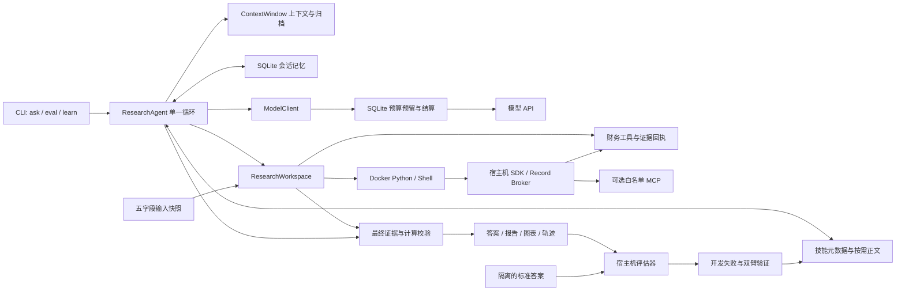

# 架构与职责边界

系统采用一个有界的模型—工具循环。交互问答、开发评估、测试评估和技能验证都调用 `ResearchAgent.run()`；它们通过不同的输入、会话与评估策略复用同一条运行路径。技能与上下文是这条路径的组成部分，不再另建一套“学习 Agent”执行器。



标准答案只连接宿主机评估器，不连接模型上下文、容器输入或对话记忆。图中的学习边表示经过隔离、独立验证与晋升后的技能更新；测试集结果不沿此边回流。

## 代码责任表

| 模块 | 主要文件 | 责任 |
| --- | --- | --- |
| 命令入口 | `src/finagent/cli.py` | 安装自检、问答、预算、导入、记忆、技能和评估命令 |
| 运行循环 | `core/agent.py` | 动作解析、技能加载、工具调用、迭代限制、结果和运行轨迹 |
| 上下文 | `core/context.py` | 固定上下文预算、大观察截断标记、旧事件归档和按页回读 |
| 输出校验 | `core/validation.py` | JSON 动作格式、已观察来源、已执行计算与最终结果的对应关系 |
| 模型与费用 | `models/client.py`、`models/budget.py` | OpenAI 兼容调用、使用量校验、原子预算预留及结算 |
| 财务工作区 | `tools/workspace.py`、`tools/store.py`、`tools/tools.py` | 输入快照、来源索引、财务方法、可信证据与计算回执 |
| 终端 | `tools/terminal.py`、`tools/terminal_process.py` | 真正的 Python/Shell、文件、后台任务、超时与进程清理 |
| 宿主机代理 | `tools/sdk.py`、`tools/records.py`、`tools/terminal_worker/` | 容器向受控财务方法发起 RPC；读取受限会话/运行记录 |
| 外部连接 | `tools/connectors.py` | 显式配置的 stdio MCP 服务及工具白名单 |
| 会话记忆 | `memory/store.py` | 按会话和文档内容作用域保存已完成轮次、事实与偏好 |
| 技能学习 | `skills/registry.py`、`learning/service.py` | 目录、正文、候选、验证、版本晋升与回滚 |
| 数据导入 | `ingestion/documents.py` | JSON、CSV、文本、PDF 文本和 XLSX 缓存值转为统一输入 |
| 评估 | `evaluation/dataset.py`、`evaluation/runner.py` | 固定 FinQA 数据版本、来源分组隔离、顺序运行及宿主机评分 |

上述代码位置均相对于仓库根目录。测试对应集中在 `tests/`，运行产物集中在所选状态目录和输出目录；运行产物不应提交进源码仓库。

## 一次请求如何执行

1. CLI 创建模型客户端、预算账本与正式技能目录。`ResearchWorkspace` 只接收已经净化的五字段 JSON：`id`、`question`、`pre_text`、`post_text`、`table`，并复制为本轮输入快照。
2. 根据文档 ID 和内容哈希计算 `scope_id`。Agent 读取相同会话、相同作用域的历史记忆，取得会话租约，避免同时写入同一会话。
3. 上下文包含系统约束、用户问题、工具声明、技能元数据、文档清单与受限记忆。模型每次返回一个 JSON 动作：加载技能、执行工具或提交最终答案。
4. 工具读取源数据后，宿主机登记实际观察的 `evidence_id`。金融计算生成 `calculation_id` 及输入引用。普通 stdout 不能自行制造可信回执。
5. 最终答案校验引用必须属于已观察证据；数值回答必须关联真实执行过的计算。通过后提交会话记忆，保存结果并关闭本轮任务；失败保存诊断并释放租约。

默认最多十四步、连续四次动作或校验失败停止、最多同时加载三个技能。限制是明确的资源边界，失败结果不会被包装为已完成答案。数值和引用校验能检查结构及执行记录，不能完全判断模型是否选对了业务口径，因此仍需要评估与失败学习。

## 上下文、记忆和技能的区别

| 机制 | 保存什么 | 可见范围 | 生命周期 |
| --- | --- | --- | --- |
| 工作上下文 | 本轮问题、动作、工具结果、已加载技能 | 当前运行 | 默认约六万字符；超过预算的事件回读归档 |
| 会话记忆 | 已完成轮次的结论、验证过的来源和计算、显式偏好 | 会话加文档内容作用域；偏好有明确作用域 | SQLite 持久保存 |
| 技能 | 不含特定题目答案的可复用研究方法 | 正式激活目录 | 版本化，验证后晋升，可禁用与回滚 |
| 失败经验 | 开发失败的问题、有限轨迹和诊断 | 学习服务 | 与技能候选及验证报告关联 |

上下文压缩是可审计的抽取与归档，不是另一次付费摘要模型调用。大观察会带有 `incomplete` 标志和归档路径；`context_read` 只能读取本轮登记过的事件，并限制返回字符范围。上下文预算按字符计算，模型费用预算另按保守 token 上界计算。

记忆检索是确定性的作用域筛选和词法排序，不宣称具有向量语义检索。失败或未提交的轮次不会成为成功事实。更换文档内容会改变作用域，防止把另一份财报的数值带入当前回答。

## 终端与宿主机边界

Docker 是默认执行后端，运行真正的 Python/Shell，而不是把 Python 表达式伪装成终端。默认关闭网络、只读容器根目录、移除 Linux capabilities、禁止提权，并限制内存、CPU、进程数、输出、文件大小、SDK 调用次数与运行时间。工作区可写，输入快照只读；模型 API 密钥不传入容器。

容器使用轻量 SDK 向宿主机 broker 请求财务操作。宿主机校验方法、参数和来源，再生成证据/计算回执；模型打印出的 JSON 即使长得像回执，也不会直接进入可信账本。后台任务有归属、轮询、停止和清理流程。容器不可用时，不会自动退回宿主机执行。

`--terminal-backend trusted-local` 是显式选择的宿主机执行模式，拥有当前用户权限；路径检查与环境清理不构成沙箱。常规 API 评估应保持 Docker 后端。

MCP 保留为可选的外部能力适配器，由宿主机启动显式配置的服务，只允许白名单工具。终端可以批量调用 SDK，MCP 可以接通已有外部服务，两者承担不同职责。外部 MCP 返回文本不会自动变成财报存储中已授权的 `evidence_id`；需要明确的数据接入和来源映射，才能用于同等强度的财务结论校验。

## 费用与评估

`ModelClient.complete()` 在请求发送前向 `BudgetLedger` 预留保守费用，响应后使用经过检查的 usage 结算。SDK 自动重试关闭。网络异常或无法验证 usage 时，保留未知请求的预留金额并冻结后续调用，避免把不确定费用当成免费请求。候选生成和验证也经过同一客户端。

账本包含既有费用承诺；新建仓库不意味着重新获得预算。所用单价与检查日期保存在账本配置中，费用是配置费率下的估算，不是供应商账单。查看状态无需付费：

```powershell
finagent --state .finagent doctor
finagent --state .finagent budget status
```

FinQA 准备器固定上游 commit 与原始文件哈希，按公司/年份来源分组抽样，开发集和测试集不共享来源组。模型只看到净化输入；标签位于 `host/gold/`，宿主机在 Agent 完成后评分。测试前冻结案例、配置和技能目录；按题顺序运行，失败同样计入分母。

当前评分是原始 `exe_ans` 尺度上的数值五位小数一致性或 yes/no 一致性，报告字段为 `custom_answer_accuracy`。它不是 FinQA 官方程序准确率，也不能直接与不同程序评分、样本或模型预算的论文结果比较。百分比尺度提示只由评估适配层加入，不应污染通用研究问答。

## 为什么收敛成这一结构

旧实验中的 AST 受限 Python 执行器、双套运行入口及评估专用 Agent 循环没有迁入新主路径。小型金融计算器仍会检查算式语法，这是确定性算术校验，不是第二套代码执行后端。终端、直接财务工具与可选 MCP 最终通过一个工作区登记可信观察。

工程方法参考了 [Dexter 的技能注册与按需加载](https://github.com/virattt/dexter/blob/534f6be455523c5926eba72bdaf4f914555be5c9/src/skills/registry.ts)、[FinRobot 的金融方法与流水线组织](https://github.com/AI4Finance-Foundation/FinRobot/tree/master/finrobot_desktop)和 [RD-Agent 的实验反馈循环](https://github.com/microsoft/RD-Agent)。本仓库的候选隔离、独立双臂验证和显式晋升是具体实现，不能因引用这些项目就声称继承其性能。

当前完整性指本地金融研究、工具执行、记忆、技能学习、审计和评估的可运行闭环。PDF 是文本提取，没有 OCR 或版面级表格恢复；XLSX 使用文件中的缓存值，不重算公式；实时行情、付费数据供应商和交易执行需要另行实现与验证，不能由一个通用 MCP 接口推断已经接入。
